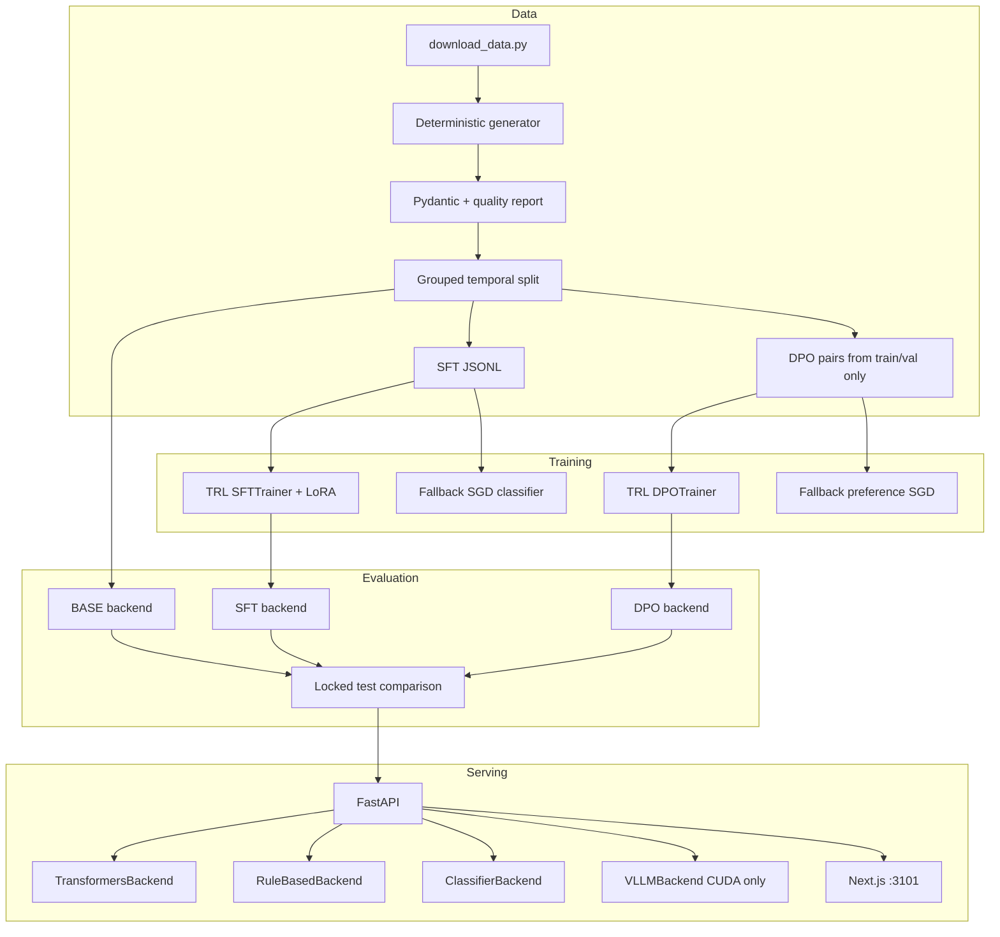

# Architecture

ResolveLM is a post-training and serving loop for **constrained incident diagnosis**, not a general chatbot.

## Pipeline

## Contracts

The operator-facing schema is `IncidentAnalysis` (`src/resolvelm/schemas/analysis.py`). Generation backends return **raw text**. `parse_analysis_with_retry` extracts JSON, repairs once (fences, trailing commas, single quotes), then validates with Pydantic. Failure yields `AnalysisErrorPayload` — never a silently filled diagnosis.

## Backends

`ModelBackend` is a Protocol with `async generate` and `generate_sync`. Production CUDA serving is intended to be vLLM in front of a Qwen3-4B-Instruct-2507 adapter. This Apple Silicon host uses rule/classifier and, when RAM allows, Transformers + LoRA.

## Leakage control

- Exact body dedup before split
- `family_id` grouping so variants never cross train/val/test
- Families ordered by earliest timestamp
- DPO rejected answers are synthetic corruptions of **train/val gold**, never test labels

## Config profiles

| Profile | Path | Executed here |
|---------|------|----------------|
| Local MPS / fallback | `configs/local/` | Yes (`make smoke`) |
| CUDA QLoRA 4B | `configs/cuda/` | No |
| Cloud A10/A100 | `configs/cloud/`, `cloud/` | No |
