# ResolveLM

**Enterprise LLM Post-Training, Alignment, Evaluation and Production Serving Platform for AI-Assisted Incident Resolution**

On-call engineers paste a service, environment, symptoms, and logs. ResolveLM returns **strict JSON**: severity, root-cause code, evidence tied to real event IDs, and prioritized actions. Invalid model text is **never** coerced into a fake diagnosis — the API retries/repairs once, then returns an error payload.

This repository is independently publishable. Local numbers below were measured on an Apple Silicon MacBook Pro (M4, 16 GB RAM, no NVIDIA GPU). Production CUDA configs target a Qwen3-4B-Instruct-class model and were **not executed here**.

## Problem

Incident response still depends on a human reading Hadoop/HDFS/OpenStack-style logs and guessing a root cause. That work is slow, inconsistent, and hard to audit. ResolveLM treats diagnosis as a constrained generation problem: supervised fine-tuning (SFT) on gold JSON, Direct Preference Optimization (DPO) against unsafe or unsupported answers, then evaluation on a **locked, grouped test split**.

## Measured results (this machine)

Values are copied from `artifacts/model_comparison.csv` and `artifacts/base_model_metrics.json` after `make smoke`. If a cell was not produced by that run, it is marked **Not benchmarked on this hardware.**

| model | backend | n | root_cause_accuracy | root_cause_macro_f1 | severity_accuracy | json_parse_success | pydantic_schema_success | supported_evidence_rate | action_f1 | latency_p50_ms |
|-------|---------|---|---------------------|---------------------|-------------------|--------------------|-------------------------|-------------------------|-----------|----------------|
| base | rule | 10 | 1.0 | 1.0 | 1.0 | 1.0 | 1.0 | 1.0 | 1.0 | 0.025 |
| sft | transformers (Qwen2.5-0.5B + LoRA) | 10 | 0.0 | 0.0 | 0.0 | 0.9 | 0.0 | 0.0 | 0.0 | 15944 |
| dpo | trl_dpo (train ran; eval not completed) | Not benchmarked on this hardware. | Not benchmarked on this hardware. | Not benchmarked on this hardware. | Not benchmarked on this hardware. | Not benchmarked on this hardware. | Not benchmarked on this hardware. | Not benchmarked on this hardware. | Not benchmarked on this hardware. | Not benchmarked on this hardware. |

The rule baseline is deterministic keyword matching on this derived corpus (perfect scores are expected, not a claim of production LLM quality). Smoke SFT on Qwen2.5-0.5B-Instruct (LoRA on MPS) produced JSON 90% of the time but **zero valid Pydantic diagnoses** — the 0.5B adapter did not learn the schema on this tiny run. DPO training completed (`train_loss=0.691` in `artifacts/dpo_train_metrics.json`); DPO test evaluation was not finished after a host Python crash (OpenMP/LightGBM SIGSEGV in a sibling process). Qwen3-4B QLoRA / vLLM throughput: **Not benchmarked on this hardware.**

## Architecture

```mermaid
flowchart LR
  raw[Raw / derived incidents] --> val[Validate]
  val --> split[Grouped temporal split]
  split --> baseEval[Base eval]
  baseEval --> sft[LoRA / QLoRA SFT]
  sft --> dpo[Preference DPO]
  dpo --> eval[Locked test eval]
  eval --> reg[MLflow registry]
  reg --> api[FastAPI backends]
  api --> ui[Next.js dashboard]
```



Serving backends implement `ModelBackend.generate()`:

- `TransformersBackend` — Hugging Face generate + optional PEFT adapter
- `VLLMBackend` — CUDA production path; raises a clear error on this Mac
- `RuleBasedBackend` / `ClassifierBackend` — deterministic baseline and sklearn fallback so API + eval always run

## Stack

| Layer | Choice |
|-------|--------|
| Data | Derived/synthetic incidents inspired by Loghub Hadoop, HDFS, OpenStack patterns |
| Training | Transformers + TRL + PEFT LoRA (QLoRA in `configs/cuda/`) |
| Fallback trainer | SGD/LogisticRegression on TF-IDF; writes real loss curves |
| Serving | FastAPI on `:8101` |
| Dashboard | Next.js App Router on `:3101` |
| Tracking | MLflow on `:5101` |
| Local Python | 3.11 via `uv`, MPS-capable PyTorch |

## Quickstart

```bash
uv python pin 3.11
uv sync --extra dev --extra train
make data          # or make smoke
make serve         # API :8101
# another terminal
make ui            # dashboard :3101
```

```bash
curl -s http://127.0.0.1:8101/health
curl -s http://127.0.0.1:8101/api/v1/incidents/analyze \
  -H 'content-type: application/json' \
  -d '{
    "service": "nova-api",
    "environment": "prod",
    "symptoms": ["Instance actions delayed"],
    "log_events": [{
      "event_id": "log-1",
      "timestamp": "2024-06-01T00:00:00Z",
      "level": "ERROR",
      "component": "nova-conductor",
      "message": "TimeoutError: QueuePool limit of size 15 overflow 10 reached"
    }]
  }'
```

## Training

- Local smoke: `configs/local/sft.yaml` and `configs/local/dpo.yaml` (tiny instruct model or fallback).
- Production CUDA: `configs/cuda/` and `cloud/` for Qwen3-4B-Instruct QLoRA. **Not executed on this hardware.**
- `make smoke` prepares a tiny corpus, runs SFT + DPO (TRL or fallback), evaluates BASE vs SFT vs DPO on the same locked test split, writes artifacts, and runs unit tests.

## Evaluation

Metrics: root-cause accuracy / macro F1 / per-class P/R / confusion; severity accuracy / macro F1; JSON parse success; Pydantic schema success; supported vs unsupported evidence rate; action precision/recall/F1; latency p50/p95. Tokens/sec and peak memory are recorded only when measured.

Never tune on test. Grouped split keeps incident variants together.

## Demo

Dashboard **Incident Analyzer** ships five marked demos: disk full, network failure, node failure, connection pool exhaustion, service timeout.

## MLOps

MLflow logs seed, LR, LoRA r/alpha/dropout/targets, batch, accum, seq len, epochs, optimizer, precision, device, train/val loss when a tracking server is up. Aliases `candidate` (SFT) and `champion` (DPO) are requested when MLflow runs.

## Tests

```bash
make test          # unit, data, model, integration, HTTP e2e
make smoke         # data + train + eval + artifacts + unit tests
```

CI (`.github/workflows/ci.yml`) does not download large weights (`HF_HUB_OFFLINE=1`).

## Reproducibility

See [REPRODUCIBILITY.md](REPRODUCIBILITY.md) and `artifacts/environment.json`. Seeds default to `42`.

## Limitations

- Research logs ≠ modern SaaS incidents. Corpus is **derived/synthetic**, inspired by public Loghub patterns, not a proprietary ticket dump.
- Remediations are template-derived; a human must still review SEV-1/SEV-2 actions.
- Local model is tiny (or a rule/classifier fallback). Do not treat local scores as 4B production quality.
- vLLM and CUDA QLoRA are documented, not run on this laptop.

## License

MIT. See [LICENSE](LICENSE).
